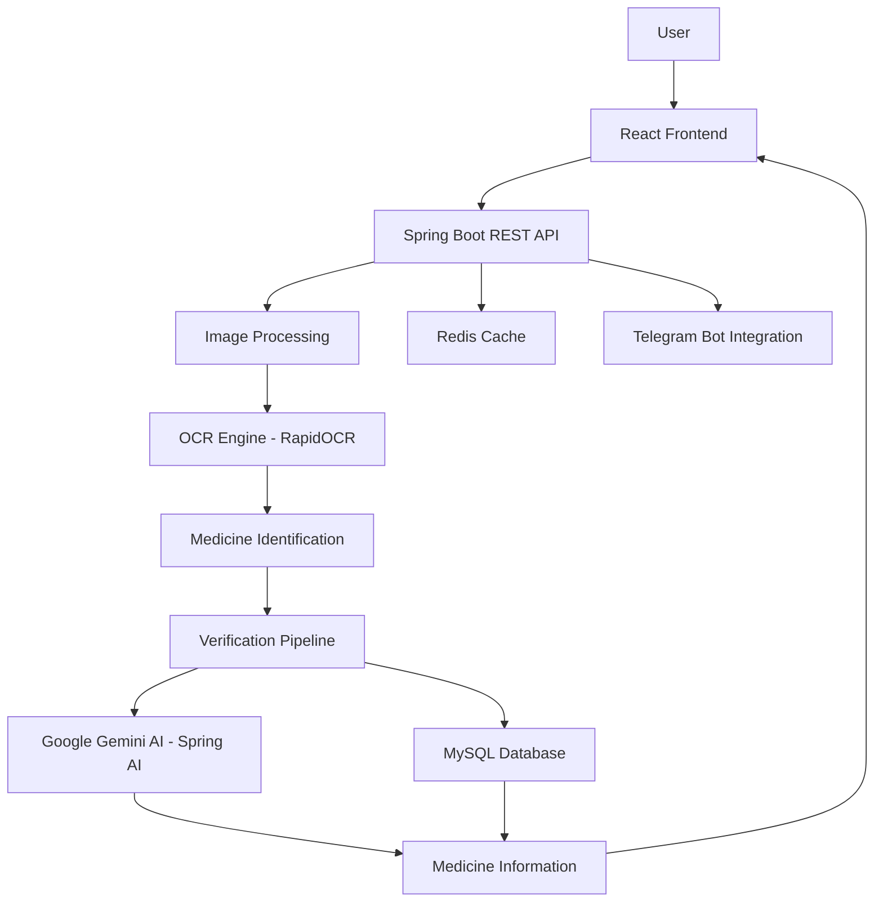

# 💊 MedScanX – AI-Powered Medicine Label Scanner

An intelligent medicine identification and information system that combines Optical Character Recognition (OCR), Spring Boot, and Google Gemini AI to extract, verify, and explain medicine information from medicine label images.

MedScanX helps users understand medicine names, composition, strength, dosage information, uses, precautions, and equivalent medicine suggestions through an easy-to-use web interface.

## 🚀 Overview

MedScanX is a full-stack AI-powered healthcare application designed to simplify medicine identification.

Users can provide medicine label images, extract relevant text using OCR, and process the extracted information through a medicine identification and verification pipeline. Google Gemini AI helps generate understandable explanations about the identified medicine.

The application uses a Java Spring Boot backend and a React frontend, with MySQL for persistent storage and Redis for caching.

## ✨ Key Features

### 🔍 Medicine Image Scanning
- Upload medicine label images.
- Extract medicine-related text using OCR.
- Process extracted information for medicine identification.

### 🧠 AI-Powered Medicine Analysis
- Google Gemini AI integration using Spring AI.
- AI-generated medicine explanations.
- Understand medicine uses and precautions.
- Dosage and strength information.
- Equivalent medicine suggestions.

### ✅ Medicine Verification Pipeline
- Medicine candidate identification.
- Brand name verification.
- Composition matching.
- Manufacturer matching.
- Strength verification.
- Configurable confidence thresholds and weighted verification.

### ⚡ Performance and Caching
- Redis caching integration.
- Spring Data JPA and Hibernate.
- MySQL database integration.

### 🌐 Web Application
- React-based frontend.
- Responsive user interface.
- Backend REST API integration.
- PDF export functionality using jsPDF and html2canvas.

### 🤖 Telegram Integration
- Telegram bot integration.
- Medicine information assistance through the configured bot.

## 🏗️ System Architecture



## 🛠️ Technology Stack

| Category | Technologies |
|---|---|
| Backend | Java 21, Spring Boot 3.4.1 |
| Backend Framework | Spring MVC, Spring Data JPA |
| AI Integration | Spring AI, Google Gemini |
| OCR | RapidOCR, ONNX Runtime |
| Database | MySQL |
| Caching | Redis |
| ORM | Hibernate |
| Frontend | React 18, JavaScript |
| Frontend Build Tool | Vite |
| PDF Export | jsPDF, html2canvas |
| Browser Automation | Playwright |
| Build Tool | Maven |
| Version Control | Git, GitHub |

## 📂 Project Structure

```text
MedScanX/
│
├── ai-medicine-assistant/
│   ├── src/
│   │   ├── main/
│   │   │   ├── java/
│   │   │   │   └── com/kovanlabs/
│   │   │   │       └── ai_medicine_assistant/
│   │   │   │           ├── config/
│   │   │   │           ├── controller/
│   │   │   │           ├── dto/
│   │   │   │           ├── entity/
│   │   │   │           ├── repository/
│   │   │   │           ├── service/
│   │   │   │           └── ...
│   │   │   │
│   │   │   └── resources/
│   │   │       └── application.properties
│   │   │
│   │   └── test/
│   │
│   ├── pom.xml
│   └── mvnw
│
├── frontend/
│   ├── public/
│   ├── src/
│   │   ├── assets/
│   │   ├── App.jsx
│   │   ├── App.css
│   │   ├── main.jsx
│   │   └── index.css
│   │
│   ├── package.json
│   └── vite.config.js
│
└── README.md
```

## ⚙️ Installation and Setup

### Prerequisites

Install the following before running the application:

- Java JDK 21
- Maven
- Node.js and npm
- MySQL Server
- Redis Server
- Google Gemini API Key

### 1. Clone the Repository

```bash
git clone https://github.com/Mathan-CR7/MedScanX.git
```

```bash
cd MedScanX
```

### 2. Configure MySQL

Create the database:

```sql
CREATE DATABASE medicine_db;
```

Update your database credentials using environment variables.

### 3. Configure Environment Variables

Configure the following environment variables on your system:

```properties
DB_PASSWORD=your_mysql_password
GEMINI_API_KEY=your_gemini_api_key
TELEGRAM_BOT_TOKEN=your_telegram_bot_token
```

Get your Gemini API key:

https://aistudio.google.com/app/apikey

**Important:** Never commit API keys, passwords, bot tokens, or `.env` files to GitHub.

### 4. Start Redis

Make sure Redis is running on its configured host and port.

Default configuration:

```text
Host: localhost
Port: 6379
```

### 5. Run the Spring Boot Backend

Open a terminal:

```bash
cd ai-medicine-assistant
```

For Windows:

```powershell
.\mvnw.cmd spring-boot:run
```

For Linux/macOS:

```bash
./mvnw spring-boot:run
```

The backend uses Spring Boot's default port unless configured otherwise.

### 6. Run the React Frontend

Open another terminal:

```bash
cd frontend
```

Install dependencies:

```bash
npm install
```

Start the development server:

```bash
npm run dev
```

Vite will display the local frontend URL in the terminal.

Open that URL in your browser.

## 🔄 Application Workflow

1. User opens the MedScanX web application.
2. User uploads a medicine label image.
3. The backend processes the uploaded image.
4. OCR extracts text from the medicine label.
5. The medicine identification pipeline evaluates possible medicine matches.
6. The verification pipeline checks brand, composition, manufacturer, and strength.
7. Spring AI integrates with Google Gemini to generate medicine explanations.
8. The application presents the processed medicine information to the user.

## 🔐 Security

- Store sensitive credentials in environment variables.
- Never expose API keys in frontend code.
- Do not upload database passwords or Telegram bot tokens.
- Keep private configuration files out of version control.
- Regenerate any credentials that have previously been exposed.

## 🎯 Project Objectives

- Simplify medicine identification using OCR.
- Integrate Generative AI into healthcare applications.
- Improve medicine information accessibility.
- Build a configurable medicine verification pipeline.
- Combine Java backend development with modern frontend technologies.
- Explore practical applications of Spring AI and Google Gemini.

## 🔮 Future Enhancements

- Medicine interaction analysis.
- Medicine expiry-date detection.
- Improved medicine database integration.
- Multilingual medicine explanations.
- Medicine history and tracking.
- Enhanced verification accuracy.
- Additional healthcare integrations.

## ⚠️ Medical Disclaimer

MedScanX is an educational and informational project. AI-generated medicine information may contain errors and must not replace professional medical advice.

Always verify medicine names, dosages, precautions, and alternatives with a qualified healthcare professional before making medication decisions.

## 👨‍💻 Developer

**Mathan Prashath R**

B.Tech – Artificial Intelligence and Data Science

GitHub: https://github.com/Mathan-CR7

Project: https://github.com/Mathan-CR7/MedScanX

---

⭐ If you find this project interesting, consider giving the repository a star!
